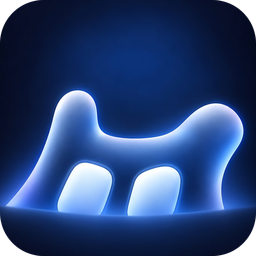

<div align="center">



# Rusty Notch

Interactive notch companion for Windows 10/11, Linux (X11), and Android, written in Rust with Slint.

[](https://github.com/Sythaz/rusty-notch/releases)
[](https://www.rust-lang.org/)
[-purple.svg?style=flat-square)](https://slint.dev/)
[%20%7C%20Android-teal.svg?style=flat-square)](#downloads-and-installation)
[](#resource-usage)
[](LICENSE)

<br/>

[Windows Setup (.exe)](https://github.com/Sythaz/rusty-notch/releases/latest/download/Rusty-Notch-Setup.exe) • [Linux Packages (.deb / .rpm / .tar.gz)](https://github.com/Sythaz/rusty-notch/releases/latest) • [Android APK (.apk)](https://github.com/Sythaz/rusty-notch/releases/latest/download/Rusty-Notch-Android-arm64.apk) • [Web Showcase](https://msyafiqaldiansyah.tech/rusty-notch)

</div>

---

## Overview

Rusty Notch is an interactive companion widget designed for screen bezels and camera cutouts. It docks to the top of your screen on desktop or wraps around your camera punch-hole on Android, showing active media playback, track progress, volume adjustments, and synchronized karaoke lyrics.

Because it compiles to native code and uses a lightweight software renderer that composites directly with the operating system window manager, it runs without a browser engine or GPU swapchain. Idle memory stays around 12 to 18 MB RAM with roughly 0.1% CPU usage.

https://github.com/user-attachments/assets/96092925-ba85-4f99-b47e-e01dc43e5ba3

---

## What Changed: v1.0.0 vs v1.2.0

| Area | Old (v1.0.0) | Current (v1.2.0) |
| :--- | :--- | :--- |
| **Platforms** | Windows only | Windows 10/11, Linux (X11 / XWayland), and Android 10+ |
| **Renderer** | GPU backend with swapchain overhead | Lightweight native software renderer with subpixel anti-aliasing (0 MB GPU VRAM, clean alpha cutouts) |
| **Idle RAM** | 25 to 35 MB | 12 to 18 MB (trimmed via operating system memory management) |
| **Mascot** | Basic blinking eyes | 8 distinct expressions (glances, squints, winks, smirks, breathing), squircle pill geometry with catchlights, and dedicated mascot color palettes |
| **Lyrics** | 3-line static display | 5-line synchronized karaoke via an online synchronized lyrics service with click-to-seek and preview scrolling |
| **Color picker** | Generic hue bar with coordinate drift | Canonical 6-stop HSV spectrum slider with 1:1 mouse tracking |
| **Window handling** | Fixed top dock | Freeform dragging across monitors, bezel docking with concave flares, floating pill mode, pin mode, and automatic hide in fullscreen apps |
| **Linux support** | None | Native media tracking, system volume monitoring, `.deb`, `.rpm`, and portable tarball installer |
| **Android support** | None | Overlay foreground service, camera cutout adaptation, media session listener, and touch gestures |

---

## Features

### Media playback and controls
- Integrates with native media subsystems: Windows SMTC, Linux MPRIS, and Android MediaSession.
- Works with media players and web browsers supporting system media integration (Spotify, YouTube Music, Apple Music, Tidal, VLC, and major browsers). CLI players such as mpv require their respective MPRIS or SMTC plugins enabled.
- Controls include play/pause, next, previous, shuffle, repeat mode, seekable progress bar, and album art.
- Cleans track titles automatically by removing tags like `[Official Music Video]` or `(Remastered 2021)`.

### Synchronized lyrics
- Fetches synchronized lyrics in a background thread from an online synchronized lyrics service.
- Clicking any line jumps track playback to that timestamp.
- Scrolling the lyrics area lets you read ahead or behind; the view snaps back to the active line after 3 seconds of inactivity.
- Lyric payloads have a 256 KB memory ceiling to prevent memory bloat on malformed responses.

### Animated companion mascot
- When media is idle, the pill displays an animated face with squircle pill eyes and specular catchlights.
- 8 behaviors: normal blink, double blink, glances across 6 directions with spring easing, curious squint, wink, smirk with blushing cheeks, periodic breathing pulse, and a goodbye reaction when closing the expanded card.
- Expression animations run declaratively, keeping idle CPU near 0.1%.

### Volume HUD
- Replaces default OS volume popups with a 2.5-second top notch overlay.
- Reads hardware volume directly from Windows Core Audio and Linux sound servers (PulseAudio or PipeWire).
- On Android, volume changes trigger a mascot glance reaction instead of blocking the system volume panel.

### Theming and colors
- 4 notch presets: Onyx, Midnight Navy, Deep Purple, and Emerald Glass.
- Full HSV slider for custom notch accents with 1:1 mouse position mapping.
- Independent mascot eye colors with 5 presets (Cyan, Pink, Gold, Emerald, Purple) or custom hue.
- Settings save automatically to `config.json`.

### Window physics and fullscreen hide
- Snaps to the top screen edge with curved concave flares blending into the monitor bezel.
- Dragging the album art badge moves the notch anywhere, switching it into a floating pill with rounded corners.
- Clicking the album art without dragging pins the expanded card open.
- Conceals itself automatically when games, video players, or presentations enter fullscreen.

---

## Downloads and Installation

### Windows 10 and 11
1. Download [Rusty-Notch-Setup.exe](https://github.com/Sythaz/rusty-notch/releases/latest/download/Rusty-Notch-Setup.exe).
2. Run the installer. It installs for the current user into `%LOCALAPPDATA%\Programs\Rusty Notch` without needing administrator privileges.
3. Check "Start Rusty Notch on Windows startup" if desired.

If Windows SmartScreen displays a warning, click **More info** then **Run anyway**. This prompt occurs on newly published applications that have not yet established Microsoft SmartScreen reputation.

https://github.com/user-attachments/assets/f33f9307-7cd6-4012-8a5b-73d8e5b0e791

### Linux (Debian, Ubuntu, Fedora, Arch)

Install system dependencies for font rendering and audio:
- Debian/Ubuntu: `sudo apt install -y libfontconfig1 pulseaudio-utils`
- Fedora/RHEL: `sudo dnf install -y fontconfig pulseaudio-utils`
- Arch Linux: `sudo pacman -S --needed fontconfig libpulse`

Choose your installation format:
- **Debian / Ubuntu (.deb)**:
  ```bash
  sudo apt install ./rusty-notch_*_amd64.deb
  ```
- **Fedora / RHEL (.rpm)**:
  ```bash
  sudo dnf install ./rusty-notch-*.x86_64.rpm
  ```
- **Portable tarball (any distribution, no root required)**:
  ```bash
  tar -xzf rusty-notch-*-linux-x86_64.tar.gz
  cd rusty-notch-*
  ./install.sh --autostart
  ```
  To uninstall later, run `./uninstall.sh`.

### Android (10+)
1. Download [Rusty-Notch-Android-arm64.apk](https://github.com/Sythaz/rusty-notch/releases/latest/download/Rusty-Notch-Android-arm64.apk) on your device.
2. Open the APK to install. Allow unknown app installation if prompted.
3. Open Rusty Notch and grant the two required permissions:
   - **Display over other apps**: draws the floating notch overlay above your screen and camera cutout.
   - **Notification access**: Android requires this permission for third-party widgets to query active media playback (`MediaSessionManager`). Rusty Notch strictly queries media playback controls and metadata; it never reads, logs, or transmits private message or notification contents.

---

## Controls and Platform Features

### Window and Navigation

| Action | Desktop (Windows / Linux) | Android |
| :--- | :--- | :--- |
| **Expand card** | Hover cursor over pill | Tap pill |
| **Collapse card** | Move cursor out (150ms delay) | Tap outside card |
| **Pin card open** | Click album art badge (without dragging) | Tap pin button in header |
| **Move window** | Drag album art badge across screens | Positioned automatically around camera cutout |
| **Reset position** | Click reset button (returns to top center) | Automatic |
| **Quick minimize** | Click minimize (`-`) button | Tap outside card |
| **Exit / close app** | Click exit (`×`) button in header | Tap exit (`×`) button in header (stops overlay service) |

### Media Playback and Lyrics

| Control | Desktop (Windows / Linux) | Android |
| :--- | :--- | :--- |
| **Play / pause** | Click play/pause button | Tap play/pause button |
| **Next track** | Click next button | Tap next button |
| **Previous track** | Click previous button | Tap previous button |
| **Timeline scrubber** | Click or drag on progress bar | Tap or drag on progress bar |
| **Shuffle mode** | Click shuffle button | Unhandled by system media session |
| **Repeat mode** | Click repeat button (Off, Track, All) | Unhandled by system media session |
| **Jump to lyric** | Click any lyric line to seek track | Tap any lyric line to seek track |
| **Preview lyrics** | Scroll mouse wheel over lyrics (snaps back in 3s) | Swipe vertically over lyrics (snaps back in 3s) |

### Personalization and System

| Feature | Desktop (Windows / Linux) | Android |
| :--- | :--- | :--- |
| **Settings view** | Click gear button in header | Tap gear button in header |
| **Theming scope** | Dual tabs: Notch Theme and Mascot Theme | Mascot Theme controls |
| **Color presets** | 4 notch presets and 5 mascot presets | 5 mascot presets |
| **Custom hue picker** | Continuous 360° HSV spectrum slider | Continuous 360° HSV spectrum slider |
| **Volume feedback** | 2.5-second top notch volume HUD overlay | Mascot reacts to volume without blocking system slider |
| **Fullscreen handling** | Conceals notch during fullscreen apps and games | Managed by Android window layers |
| **Update notice** | Accent dot on gear and update pill in settings | Notification from release download |

---

## Resource Usage

| Metric | Electron Widgets | Rusty Notch |
| :--- | :--- | :--- |
| **Idle RAM** | 350 to 500 MB | 12 to 18 MB |
| **Idle CPU** | 1.5% to 5.0% | ~0.1% |
| **Direct GPU VRAM** | 100 to 250 MB | 0 MB (CPU software rasterizer, no GPU swapchain) |
| **Runtime dependencies** | Chromium, Node.js | None (compiled binary) |
| **Installer / package size** | 120 to 180 MB | ~8 MB (.exe) / ~10 MB (.apk) |

---

## Configuration

Preferences are stored in `config.json`:
- Windows: `%LOCALAPPDATA%\rusty_notch\config.json`
- Linux: `~/.config/rusty-notch/config.json`

```json
{
  "theme_id": "midnight",
  "custom_hue": 0.58,
  "accent_hex": "#0A84FF",
  "mascot_hue": 0.552,
  "skipped_version": null
}
```

---

## Privacy and Network

- No analytics, telemetry, or user tracking SDKs.
- Network activity is limited strictly to two functional tasks:
  1. Synchronized lyrics lookup: fetches song lyrics during active media playback, transmitting track title, artist name, and IP address to public lyrics databases over HTTPS.
  2. Version checks: checks an official remote endpoint once every 12 hours for new version notifications.
- Memory usage is proactively managed through periodic working set trimming via native operating system calls.

---

## Author and License

Muhammad Syafiq Aldiansyah (Sythaz)
- Portfolio: [msyafiqaldiansyah.tech](https://msyafiqaldiansyah.tech)
- GitHub: [@Sythaz](https://github.com/Sythaz)

Rusty Notch is distributed as **Proprietary Freeware**. It is free to use for personal, educational, and commercial purposes. You may redistribute original, unmodified binary packages free of charge. The application is closed-source; free use does not imply open source. See the full [LICENSE](LICENSE) for terms, restrictions, and disclaimers.

### Disclaimers
- **Trademarks**: Apple, Dynamic Island, Spotify, YouTube Music, Apple Music, Tidal, Windows, and Linux are trademarks of their respective owners. Their mention does not imply sponsorship, affiliation, or endorsement.
- **Lyrics Content**: Lyrics displayed by the application are retrieved from public community databases. All lyrics remain the intellectual property of their respective copyright owners and songwriters.
